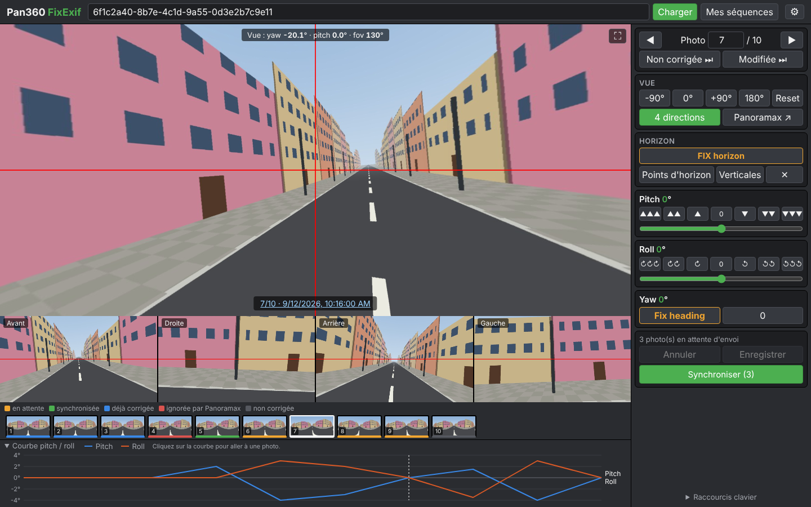
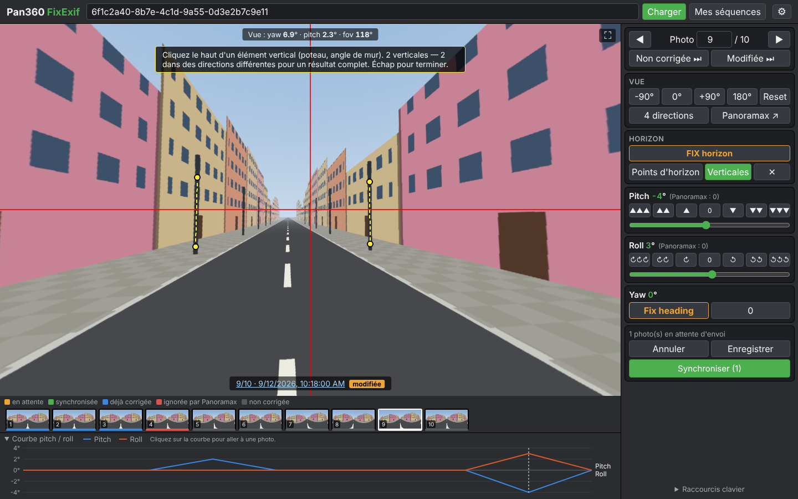

# Pan360 FixExif

Application web 100 % JavaScript (statique, sans build) pour corriger en **WYSIWYG** l'orientation
**pitch / roll / yaw** de vos photos 360° publiées sur [Panoramax](https://panoramax.fr).

👉 En ligne : **https://panofix.my-heb.eu/**



- **Ce que vous voyez est ce que Panoramax affichera** : l'app utilise
  [Photo Sphere Viewer](https://photo-sphere-viewer.js.org/), la même bibliothèque, avec la même
  transformation et la même vue d'ouverture que le viewer officiel Panoramax.
- Les corrections sont visibles en direct, puis envoyées à l'API Panoramax
  (`PATCH /api/collections/{collection}/items/{photo}` avec `pitch`, `roll`, `yaw`).
- Aucun serveur : le token et les modifications en attente restent dans votre navigateur.

## Démarrage rapide

1. Ouvrir l'application, puis les **paramètres ⚙** :
   - l'**instance** Panoramax (par défaut `https://panoramax.openstreetmap.fr`) ;
   - votre **token** Panoramax (nécessaire pour enregistrer et pour « Mes séquences »).
     Cochez « Mémoriser » pour le garder dans le navigateur ; sinon il est oublié à la fermeture de l'onglet.
2. Coller l'URL d'une séquence (page Panoramax contenant `seq=…`, URL d'API `…/api/collections/<id>/items`,
   ou l'identifiant seul) puis **Charger** — ou choisir dans **Mes séquences**.
3. Corriger les photos (voir ci-dessous), puis **Synchroniser**.

## L'interface

Tout tient sur un écran, sans défilement :

- **À gauche** : la photo, la **vue 4 directions** optionnelle (avant / droite / arrière / gauche), la
  **bande de miniatures** et la **courbe pitch / roll** de la séquence.
- **À droite** : toutes les commandes — navigation, orientation de la vue, outils d'horizon, pitch, roll,
  yaw et enregistrement.

### Outils de correction

| Outil | Comment | Quand l'utiliser |
|---|---|---|
| **FIX horizon** (A) | Monter / descendre la vue pour poser l'horizon réel sur la ligne rouge, puis FIX. Fonctionne dans n'importe quelle direction. | Correction rapide ; refaire à 0° puis à 90° pour un résultat parfait. |
| **Points d'horizon** (H) | Cliquer au moins 2 points de l'horizon réel, idéalement éloignés de 90° ou plus. Pitch et roll sont calculés d'un coup ; chaque point ajouté affine. | Horizon dégagé (campagne, bord de mer). |
| **Verticales** (J) | Cliquer le haut puis le bas d'éléments verticaux (poteaux, angles de murs). 1 verticale corrige en partie, 2 dans des directions différentes suffisent. | En ville : la méthode la plus fiable. |
| **Pas fins** | ▲/▼ (pitch), ↻/↺ (roll) de 1°, 5° ou 10°, curseurs de -90° à +90°, « 0 » pour remettre à zéro. | Retouche manuelle. |
| **Fix heading** (E) | Tourner la vue vers la direction qui doit s'afficher à l'ouverture, puis Fix heading. | Corriger le yaw. |



Les outils d'horizon ne modifient jamais le yaw, et les repères cliqués restent affichés en jaune.
**Échap** quitte le mode, **✕** efface les repères.

### Suivi de la séquence

- **Miniatures** : chaque photo porte un statut — en attente d'envoi, synchronisée, déjà corrigée,
  ignorée par Panoramax, non corrigée. Boutons **Non corrigée ⏭** (N) et **Modifiée ⏭** (M).
- **Courbe pitch / roll** : repère les photos qui sortent de la tendance ; survol = valeurs, clic = ouvre la photo.
- **Panoramax ↗** (O) : ouvre la photo courante sur le site Panoramax pour comparer.

Les modifications non envoyées sont conservées dans le navigateur : vous pouvez fermer l'onglet et
reprendre plus tard. L'URL (`#seq=…&img=…`) permet de revenir directement à une photo.

## Raccourcis clavier

Liés à la position physique des touches (libellés ci-dessous en **AZERTY** ; l'aide intégrée affiche
les touches de votre clavier quand le navigateur le permet).

| Touche | Action |
|---|---|
| **A** ou **Z** | FIX horizon |
| **H** / **J** / **Échap** | Mode points d'horizon / mode verticales / quitter le mode |
| **E** | Fix heading |
| **Q** / **S** / **D** / **F** | Vue à -90° / 0° / +90° / 180° (0° = sens de déplacement) |
| **X** | Vue par défaut |
| **W** / **C** (ou PgUp / PgDn) | Photo précédente / suivante |
| **N** / **M** | Photo non corrigée suivante / photo modifiée suivante |
| **G** | Vue 4 directions |
| **O** | Ouvrir la photo dans Panoramax |
| **V** | Synchroniser vers Panoramax |
| **← →** / **↑ ↓** | Tourner la vue (5°) / l'incliner finement (0,2°) |

## Lancer en local

Aucun build. Au choix :

```bash
# Docker (nginx) — puis http://localhost:8080
docker compose up --build

# ou n'importe quel serveur statique
python3 -m http.server 5555   # puis http://127.0.0.1:5555
```

Avec `docker compose`, les fichiers du dépôt sont montés dans le conteneur : une modification est
visible au simple rechargement de la page. Pour une image autonome : `docker build -t pan360-fixexif .`
puis `docker run --rm -p 8080:80 pan360-fixexif`.

## Mise en ligne (GitHub Pages)

**Settings → Pages** → *Deploy from a branch*, branche `main`, dossier `/ (root)`. Le fichier `CNAME`
définit le domaine personnalisé.

## Bon à savoir

- **Champs du PATCH** : `pitch`, `roll`, `yaw` sans préfixe (le préfixe `pers:` n'existe qu'en lecture).
  Plages acceptées par le serveur : pitch et roll entre -90° et 90°, yaw entre 0° et 360°.
- Le viewer Panoramax n'applique la correction d'une photo 360° **que si pitch et roll sont tous deux
  non nuls**. Ces photos sont signalées (« ignorée par Panoramax ») et, à l'envoi, un angle nul est
  remplacé par 0,01° (invisible) pour que la correction soit prise en compte.
- Comme Panoramax, l'app ignore l'orientation XMP inscrite dans le fichier image et ouvre la vue dans le
  sens de déplacement (GPS des photos voisines et `view:azimuth`).
- Seul le propriétaire des photos (ou un administrateur) peut les modifier.
- Le token est stocké en clair dans le stockage local du navigateur et n'est envoyé qu'à l'instance
  configurée. N'utilisez pas « Mémoriser » sur un ordinateur partagé.

Les captures ci-dessus ont été réalisées sur une scène de rue synthétique.

## Contribuer

Voir la [documentation développeur](docs/DEVELOPPEMENT.md) et [AGENTS.md](AGENTS.md).
